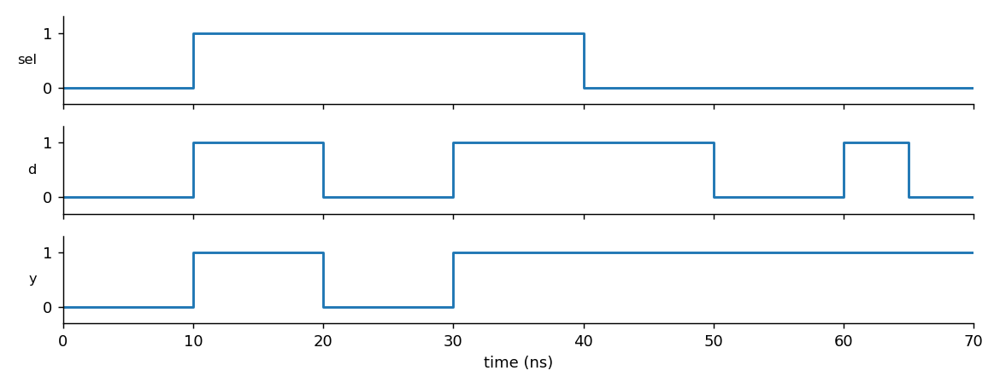
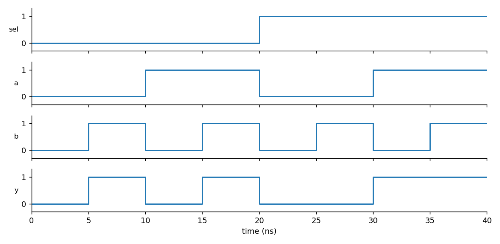
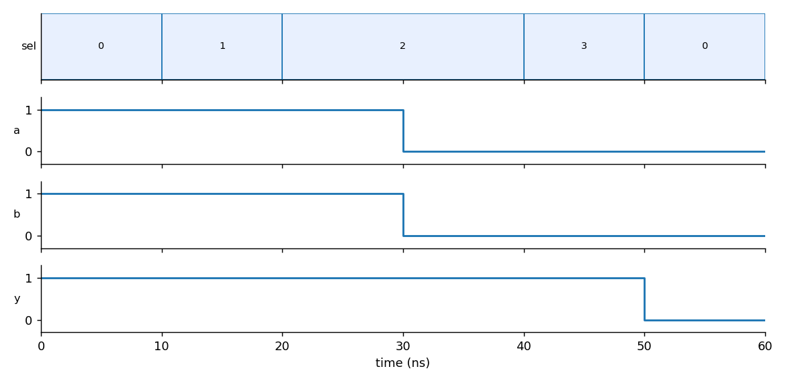
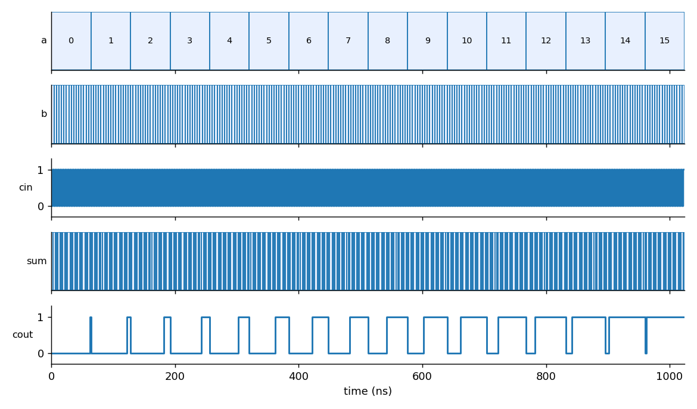

# Module 5 – RTL Optimization: IF, CASE and FOR Constructs

## Overview

This module looks at how the way you write conditional and loop constructs in Verilog decides what hardware the synthesis tool builds. A small coding slip (an `if` without an `else`, a `case` with a missing item) produces a **latch** you never asked for. A loop, on the other hand, produces **replicated hardware**, not repeated execution in time.

Every design in this module has a self-checking testbench. Each synthesizable design was simulated with Icarus Verilog, synthesized with Yosys against the SKY130 HD typical library (`sky130_fd_sc_hd__tt_025C_1v80`), and then re-simulated at gate level with the same testbench.

## Tools

| Tool | Use |
|---|---|
| Icarus Verilog (`iverilog`, `vvp`) | RTL and gate-level simulation |
| GTKWave | Waveform viewing (`.vcd` files) |
| Yosys | Logic synthesis, technology mapping |
| SKY130 `sky130_fd_sc_hd` | Standard-cell library (liberty + Verilog models) |

## Folder layout

```
Module 5/
├── README.md
├── images/                      waveform plots rendered from the simulation VCDs
└── labs/
    ├── lab01_if_constructs/     if_latch, if_complete, if_priority
    ├── lab02_case_constructs/   case_latch, case_full, case_overlap
    └── lab03_for_and_generate/  mux8_for, demux8_generate, rca4_generate
```

Each lab folder has a `Makefile`. From the lab folder:

```bash
make all            # simulate + synthesize + gate-level simulate every design in the lab
make sim-<name>     # RTL simulation of one design
make synth-<name>   # Yosys synthesis of one design
make gls-<name>     # gate-level simulation of one design
```

Run `bash scripts/setup.sh` once at the repo root first; it downloads the liberty file and cell models into `lib/`.

---

## 1. IF constructs

### 1.1 Incomplete IF → latch (`if_latch.v`)

```verilog
always @(*) begin
    if (sel)
        y = d;          // no else: what is y when sel = 0?
end
```

When `sel = 0` the code says nothing about `y`, so the only legal behaviour is "keep the old value". Combinational logic cannot remember anything, so the synthesizer inserts a level-sensitive latch (enable = `sel`, data = `d`).



In the waveform `y` follows `d` while `sel = 1` (10 to 40 ns). After `sel` falls at 40 ns, `d` keeps toggling but `y` stays at 1.

Yosys result: **1 cell, `$_DLATCH_P_`**. No mux appears.

### 1.2 Complete IF → multiplexer (`if_complete.v`)

```verilog
always @(*) begin
    if (sel) y = a;
    else     y = b;
end
```



Yosys result: **1 cell, `sky130_fd_sc_hd__mux2_1`** (area 11.2608). Simulation: 8/8 vectors pass, and the gate-level simulation of the netlist also passes.

### 1.3 IF / ELSE IF chain (`if_priority.v`)

An `if … else if … else` chain gives the first condition priority. Here `req[2]` beats `req[1]` beats `req[0]`. The final `else` keeps the logic complete.

Yosys result: 3 cells (`a21o_1`, `clkinv_1`, `lpflow_inputiso1p_1`), area 17.5168. Simulation and gate-level simulation both pass.

> The `lpflow_*` cells are SKY130 low-power-flow cells. ABC picks them freely when no `dont_use` list is given. A full OpenLANE run excludes them through the PDK configuration.

---

## 2. CASE constructs

### 2.1 Incomplete CASE → latch (`case_latch.v`)

```verilog
case (sel)
    2'b00: y = a;
    2'b01: y = b;
endcase               // 2'b10 and 2'b11 are not covered, no default
```



For `sel = 2` and `sel = 3` the output holds the last value (1) even when `a` and `b` both drop to 0 at 30 ns. At 50 ns `sel` returns to 0 and `y` follows `a` again.

Yosys result: 4 cells = `$_DLATCH_N_` + `mux2_1` + `nand2b_1` + `buf_1`. The latch is the cost of the missing items.

### 2.2 Complete CASE (`case_full.v`)

A 4:1 mux with all four items and a `default`. Yosys maps the whole design to **one `sky130_fd_sc_hd__mux4_2`** (area 22.5216). Simulation, 64/64 vectors, passes at RTL and gate level.

### 2.3 casez with overlapping items (`case_overlap.v`)

`casez` lets `?` act as a wildcard, so `2'b1?` matches both `10` and `11`. Items are evaluated top-down and the first match wins, so overlapping items create priority behaviour. Here the logic reduces to 2 cells (area 10.0096), and tests pass at RTL and gate level.

### Rules to remember

- Assign every output in every branch, or assign a default value at the top of the block.
- Always add `default` to a `case` used for combinational logic.
- In a clocked block an incomplete `if` is fine: the flop already holds state.

---

## 3. FOR loops and generate

### 3.1 FOR loop inside `always` (`mux8_for.v`)

```verilog
y = 1'b0;
for (k = 0; k < 8; k = k + 1)
    if (sel == k) y = d[k];
```

The loop is unrolled at elaboration into eight comparators and selectors, and ABC then recovers the obvious structure: **2× `mux4_2` + 1× `mux2_1`** (3 cells, area 56.304). Simulation: 2048/2048 vectors pass at RTL and gate level.

### 3.2 generate-for demultiplexer (`demux8_generate.v`)

`generate … for` replicates `assign` statements, so each output bit gets its own `(sel == g) ? din : 0` logic.

Yosys result: 8 cells (`and4`, `and4b` ×3, `nor4b`, `nor4bb` ×3), area 77.5744. Simulation passes at RTL and gate level.

### 3.3 generate-for ripple-carry adder (`rca4_generate.v`)

Four full-adder instances chained through a carry vector `c[4:0]`.



Yosys result: **4× `xor3_1` + 4× `maj3_1`** (8 cells, area 135.1296), one xor3 for each sum bit and one maj3 for each carry. 512/512 vectors pass at RTL and gate level.

---

## 4. Results summary

All numbers come from the logs saved in each lab's `results/` folder.

| Design | Hardware inferred | Cells | Area (µm²) | RTL sim | GLS |
|---|---|---|---|---|---|
| `if_latch` | latch (`$_DLATCH_P_`) | 1 | n/a (latch unmapped) | behaviour checked | not run |
| `if_complete` | 2:1 mux | 1 | 11.2608 | PASS | PASS |
| `if_priority` | priority logic | 3 | 17.5168 | PASS | PASS |
| `case_latch` | mux + latch | 4 | 21.2704 (excl. latch) | behaviour checked | not run |
| `case_full` | 4:1 mux | 1 | 22.5216 | PASS | PASS |
| `case_overlap` | wildcard decode | 2 | 10.0096 | PASS | PASS |
| `mux8_for` | 8:1 mux | 3 | 56.3040 | PASS | PASS |
| `demux8_generate` | 1:8 demux | 8 | 77.5744 | PASS | PASS |
| `rca4_generate` | 4-bit RCA | 8 | 135.1296 | PASS | PASS |

**Why latches are not mapped here:** the Yosys release used (0.33) with `dfflibmap` only maps flip-flops. The latch stays as a generic `$_DLATCH_*_` cell, so its area is reported as unknown. The latch-inference lesson does not depend on mapping, because the `$_DLATCH_` cell showing up in the netlist is the evidence. OpenLANE's Yosys script performs the latch mapping.

## 5. Learning outcomes

- Spot an unintended latch from the code and from the synthesis report.
- Write IF and CASE blocks that synthesize to muxes.
- Understand priority logic from `if / else if` chains and top-down `casez` matching.
- Use `for` and `generate` loops to describe replicated hardware.
- Compare RTL and gate-level simulation of the same design with one testbench.

## 6. Reproduce

```bash
bash scripts/setup.sh                       # once
cd "Module 5/labs/lab01_if_constructs"
make all
make sim-if_latch                           # latch behaviour
gtkwave results/if_latch.vcd
```
